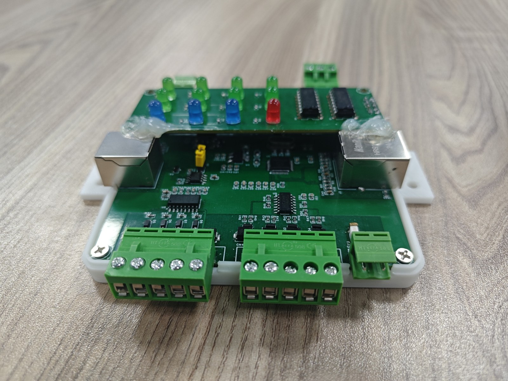
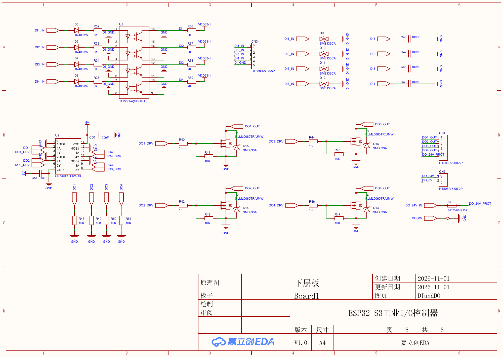

# ESP32-S3 Industrial I/O Controller

[中文说明](README.zh-CN.md) · [Firmware development](docs/development.md) · [Schematics](hardware/schematics/README.md) · [Bottom enclosure STL](hardware/3d/README.md)

A two-board controller with four optocoupled digital inputs, four MOSFET digital outputs, RS485 Modbus RTU, CAN, W5500 Ethernet, and Wi-Fi. The ESP32-S3 hosts a browser console for I/O, bus diagnostics, network configuration, and firmware updates.

## Build and run

Use **ESP-IDF 6.1** with ESP32-S3 and 16 MB flash. Run these commands in an activated ESP-IDF terminal.

~~~sh
git clone https://github.com/1760hwy/esp32_s3_aiot.git
cd esp32_s3_aiot/firmware
idf.py set-target esp32s3
idf.py menuconfig
~~~

In **IOT5 Web console**, configure the administrator credentials. The username defaults to `admin`. Use 1–31 characters for the username and 12–63 for the password. Both accept letters, digits, dots, underscores, and hyphens. The password defaults to empty, which leaves the console disabled. Keep the credential-bearing `sdkconfig` and firmware image private.

~~~sh
idf.py build
idf.py -p <PORT> flash monitor
~~~

Replace `<PORT>` with your serial port. On first boot, connect the W5500 to a trusted local network with DHCP, check the serial log or DHCP leases for the assigned address, and open `http://<device-address>:8080/`. Configure Wi-Fi from the network tab. The console uses HTTP and is intended for an isolated LAN.

The browser uses a session cookie. Other clients can send a form-encoded `POST /api/login` with `user` and `pwd`, then use `Authorization: Bearer <token>`. One administrative session is valid at a time, with a maximum lifetime of 24 hours. Signing in again, signing out, or rebooting invalidates the previous token.

The first serial flash installs the bootloader, [partition table](firmware/partitions.csv), and application. Later OTA updates take `build/sample_project.bin` and require the matching partition table. Automatic bootloader rollback is disabled in this configuration.

## Develop the firmware

[app_main()](firmware/main/main.c) starts the I/O, network, RS485, CAN, and Web modules. The `BSP` directories contain board drivers. The `Logic` directories contain the bus engines, indicator logic, and browser console. To learn how they fit together, follow the [development guide](docs/development.md) and the [worked C example](docs/development.zh-CN.md#练习新增只读-di-汇总接口). The example adds an authenticated, read-only DI summary route and shows how to register a new source file and include directory in CMake.

## Hardware and enclosure

| Resource | Contents |
| --- | --- |
| [Hardware files and GPIO mapping](hardware/README.md) | EasyEDA Pro project, PCB1 Gerber, two-board reference BOM, and firmware pin assignments |
| [Schematic gallery](hardware/schematics/README.md) | All six sheets, with [PCB1 PDF](hardware/schematics/pcb1.pdf) and [PCB2 PDF](hardware/schematics/pcb2.pdf) |
| [3D bottom enclosure](hardware/3d/README.md) | STL mesh and import dimensions |

PCB1 is the lower control board. PCB2 is the upper indicator board, driven by two cascaded 74HC595 registers. Export the upper-board Gerber from the EDA source before fabricating the full assembly.

## Verification status

The release firmware and the DI extension example have been built with ESP-IDF 6.1.0. [Bench photos and early UI screenshots](README.zh-CN.md#硬件和演示) document the prototype. Device-side verification of this release, bus interoperability, OTA, and enclosure fit remains pending. The STM32 peer and FastAPI agent are separate integration components.

## License

Original firmware, hardware design, bottom enclosure model and project documentation are available under the [Apache License, Version 2.0](LICENSE). ESP-IDF, [managed dependencies](firmware/dependencies.lock), and third-party libraries and models retain their respective licenses.
