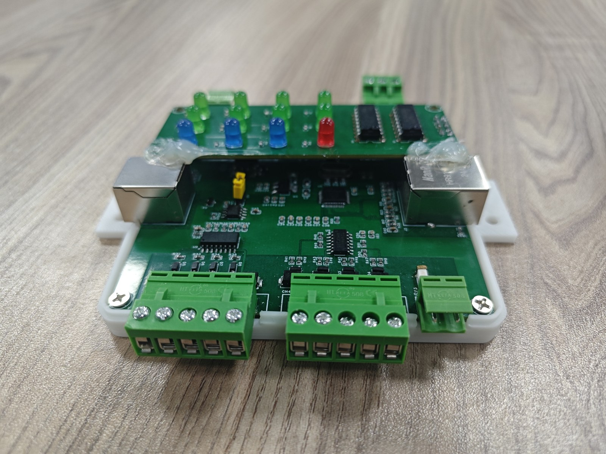
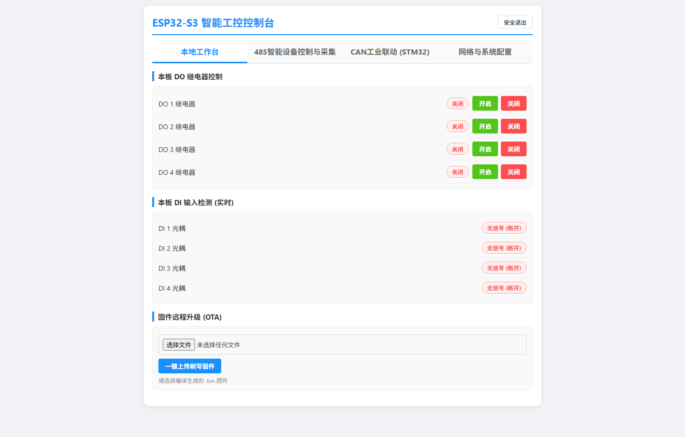

# ESP32-S3 工业 I/O 控制器

[English](README.md) · [二次开发指南](docs/development.zh-CN.md) · [原理图](hardware/schematics/README.md) · [3D 底壳](hardware/3d/README.md)

一套可通过浏览器调试的 ESP32-S3 双板控制器，集成 4 路 DI、4 路 MOSFET 数字量输出（DO）、RS485 Modbus RTU、CAN、W5500 以太网与 Wi-Fi。

| 功能 | 固件实现 |
| --- | --- |
| 本地 I/O | 四路 DI 状态读取、四路 MOSFET DO 控制 |
| RS485 | 初始波特率 9600 bps，支持设备模板、轮询、自定义点位与报文调试 |
| CAN | TWAI，500 kbps，支持报文监视、发送及 STM32F407 联动入口 |
| 网络 | W5500 支持 DHCP 和静态 IP，Wi-Fi 支持配置及断电重连 |
| Web 与 OTA | HTTP 控制台监听 8080，支持上传应用镜像到备用 OTA 分区 |

截图来自早期固件，发布版将板载通道统一标注为 DO 输出。

## 编译和接入

在已激活的 **ESP-IDF 6.1** 终端中运行以下命令。本项目使用 ESP32-S3、16 MB Flash 和 [双 OTA 分区](firmware/partitions.csv)。

~~~sh
cd firmware
idf.py set-target esp32s3
idf.py menuconfig
~~~

进入 **IOT5 Web console** 配置凭据。账号为 1～31 字符，密码为 12～63 字符，均可使用字母、数字、点、下划线和连字符。账号默认是 `admin`，密码初始为空。凭据为空或格式无效时 Web 服务保持关闭。含实际密码的 `sdkconfig` 和编译后的固件镜像应留在本机。

~~~sh
idf.py build
idf.py -p <PORT> flash monitor
~~~

初次启动时可把 W5500 网口接入带 DHCP 的可信测试网络，从串口日志或 DHCP 列表查看地址，在浏览器打开 `http://<设备地址>:8080/`。Web 控制台使用 HTTP，适用于隔离局域网调试。登录后可在网络页设置 Wi-Fi。

浏览器使用 Cookie 维持会话。外部客户端可向 `POST /api/login` 提交表单字段 `user` 和 `pwd`，再用响应中的令牌构造 `Authorization: Bearer <token>`。同时保留一个管理员会话，有效期 24 小时。再次登录、退出或重启会使旧令牌失效。旧客户端需迁移固定令牌和 URL 参数用法。

首次使用串口 `flash` 写入引导程序、分区表和应用。后续网页 OTA 使用 `build/sample_project.bin`，要求设备已运行与本工程相符的分区表。当前配置未启用引导程序自动回滚，测试升级时应保留串口恢复通道。

## 二次开发

从固件入口、驱动层和业务层开始，按指南完成一个带鉴权的只读 DI 汇总接口，并对照 Web 控制台做验收。 [二次开发指南](docs/development.zh-CN.md)

## 硬件和演示

- [6 页原理图](hardware/schematics/README.md)可直接展开查看，另有 PDF 下载。[3D 底壳](hardware/3d/README.md)提供 STL 和导入尺寸。
- [硬件资料](hardware/README.md)提供嘉立创 EDA 工程、两板原理图、下层板 Gerber、参考 BOM 及固件 GPIO 对照。
- [接线照片](docs/images/bench-wiring.jpg)展示台架布置。[RS485 页面](docs/images/web-rs485.png)截图显示设备离线，[CAN 页面](docs/images/web-can.png)截图显示收发计数为 0。
- [FastAPI Swagger](docs/images/external-fastapi-swagger.png)是外部联动接口展示。随附源码覆盖 ESP32-S3 固件，复刻 FastAPI Agent 和 STM32 从机联动需另备对应软件与接线。

## 许可

原创固件、硬件设计、底壳模型和项目文档采用 [Apache License 2.0](LICENSE)。ESP-IDF、[组件依赖](firmware/dependencies.lock)、第三方库和模型沿用各自上游授权。照片的权利由各自权利人保留。
