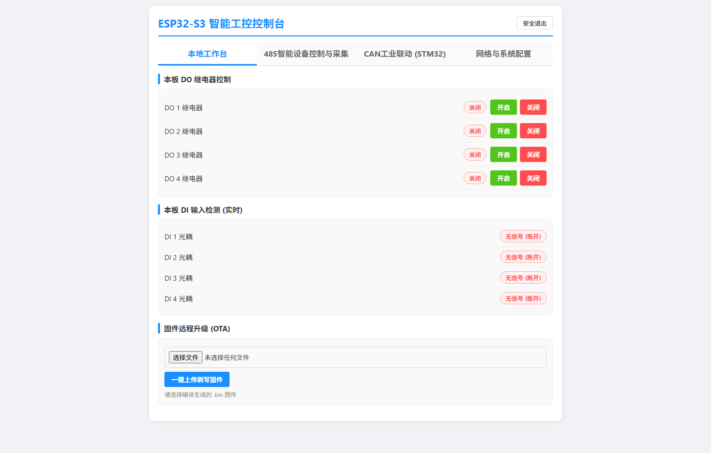

# ESP32-S3 固件二次开发指南

本指南适用于希望修改控制逻辑、加入 Modbus 设备或扩展 Web API 的读者。先按 [编译与接入](../README.zh-CN.md#编译和接入) 构建原版固件，再进行下面的练习。开发环境为 ESP-IDF 6.1，目标为 ESP32-S3 和 16 MB Flash。

## 从哪里读代码

~~~mermaid
flowchart LR
    Main["app_main()"] --> Logic["业务层 Logic"]
    Main --> Net["W5500 / Wi-Fi BSP"]
    Browser["浏览器 / HTTP 客户端"] --> Web["WebServer · 鉴权与路由"]
    Logic --> Web
    Web --> DI["DI / DO BSP"]
    Web --> Bus["RS485Engine / CANEngine"]
    Bus --> Drivers["UART / TWAI BSP"]
    Logic --> LEDs["DIDO595 / Network595"]
    LEDs --> Shift["74HC595 BSP"]
~~~

| 想改什么 | 从这里开始 | 现有实现 |
| --- | --- | --- |
| 启动顺序、默认端口 | [main.c](../firmware/main/main.c) | 初始化指示灯与 DI/DO、Wi-Fi、W5500、RS485、CAN，再启动 Web |
| 引脚和输入有效电平 | [DI 驱动](../firmware/main/BSP/DI/app_DI.c)、[DO 驱动](../firmware/main/BSP/DO/app_DO.c)、[GPIO 表](../hardware/README.md#gpio-mapping) | DI 经光耦反相。应用读取的 true 表示输入有效 |
| 指示灯 | [DIDO595](../firmware/main/Logic/DIDO595/app_dido595.c)、[Network595](../firmware/main/Logic/Network595/app_network595.c)、[595 驱动](../firmware/main/BSP/595/595.c) | 业务层汇总状态，驱动层控制移位寄存器 |
| Modbus 点位 | [RS485Engine](../firmware/main/Logic/RS485Engine/app_rs485_engine.c)、[点位定义](../firmware/main/Logic/RS485Engine/include/app_rs485_engine.h) | 管理点位、模板、轮询和串口访问。默认 9600 bps |
| CAN 应用协议 | [CANEngine](../firmware/main/Logic/CANEngine/app_can_engine.c)、[CAN 驱动](../firmware/main/BSP/CAN/app_can.c) | 引擎处理报文和日志，驱动配置 TWAI。默认 500 kbps |
| 网页和 HTTP | [WebServer](../firmware/main/Logic/WebServer/app_webserver.c) | HTML/JavaScript 位于 INDEX_HTML，URI 在 app_webserver_start() 中集中注册 |
| W5500 与 Wi-Fi | [网络驱动](../firmware/main/BSP/network/app.network.c)、[Wi-Fi 驱动](../firmware/main/BSP/wifi/app_wifi.c) | 处理网口地址和 Wi-Fi 配置 |
| 编译输入与依赖 | [CMakeLists.txt](../firmware/main/CMakeLists.txt)、[组件清单](../firmware/main/idf_component.yml)、[分区表](../firmware/partitions.csv) | SRCS 和 INCLUDE_DIRS 显式列出源码与头文件目录 |

## 练习：新增只读 DI 汇总接口

在自己的工作分支操作。完成后 GET /api/di/summary 返回四路输入中有效的数量，既能练习“驱动 → 业务 → HTTP”的调用路径，也能用现有 GET /api/di 交叉验证。

### 1. 写业务模块

创建 `firmware/main/Logic/DISummary/include/app_di_summary.h`。

~~~c
#pragma once

#include <stdint.h>

uint8_t app_di_count_active(void);
~~~

创建 `firmware/main/Logic/DISummary/app_di_summary.c`。DI 初始化由原工程的 `app_dodi595_init()` 完成，业务函数直接使用现有驱动读取有效状态。

~~~c
#include "app_di_summary.h"
#include "app_DI.h"

uint8_t app_di_count_active(void)
{
    uint8_t active = 0;
    for (uint8_t channel = 1; channel <= 4; ++channel) {
        if (bsp_di_get_raw(channel)) {
            ++active;
        }
    }
    return active;
}
~~~

### 2. 登记编译文件

在 `firmware/main/CMakeLists.txt` 的 `SRCS` 中添加 `"Logic/DISummary/app_di_summary.c"`，在 `INCLUDE_DIRS` 中添加 `"Logic/DISummary/include"`。这两个路径都以 `firmware/main` 为基准。

### 3. 接到现有 HTTP 服务

在 `app_webserver.c` 顶部加入 `#include "app_di_summary.h"`，在 `di_get_handler()` 后面加入处理函数。`CHECK_AUTH` 使用原工程的浏览器 Cookie 或 Bearer 会话鉴权。

~~~c
static esp_err_t di_summary_get_handler(httpd_req_t *req)
{
    CHECK_AUTH(req);
    char body[32];
    snprintf(body, sizeof(body), "{\"active\":%u}",
             (unsigned)app_di_count_active());
    httpd_resp_set_type(req, "application/json");
    return httpd_resp_sendstr(req, body);
}
~~~

在 `app_webserver_start()` 的 `uris[]` 里，紧跟现有 `/api/di` 注册这一行。项目的路由数量受 `config.max_uri_handlers` 限制，继续加接口时要检查余量。

~~~c
{ .uri = "/api/di/summary", .method = HTTP_GET, .handler = di_summary_get_handler },
~~~

### 4. 构建和观察结果

在已启用 ESP-IDF 的终端进入仓库 `firmware` 目录运行 `idf.py build`。构建日志应出现示例的 `app_di_summary.c` 编译记录，生成 `build/sample_project.bin`。首次配置凭据和使用测试设备烧录时按 [快速上手](../README.zh-CN.md#编译和接入) 操作。

在同一台设备的 Web 页面登录后，打开浏览器开发者工具的控制台，运行下面的脚本。读数比较期间保持输入状态稳定。

~~~javascript
async function readIo(path) {
    const response = await fetch(path);
    if (!response.ok) throw new Error(`HTTP ${response.status}: ${path}`);
    return response.json();
}

const di = await readIo("/api/di");
const summary = await readIo("/api/di/summary");
const expected = di.di1 + di.di2 + di.di3 + di.di4;
console.log({ expected, reported: summary.active });
~~~

预期 `reported` 等于 `expected`，范围为 0 到 4。退出登录后访问新接口应返回 HTTP 401。编译找不到头文件时查 `INCLUDE_DIRS`，链接找不到函数时查 `SRCS`。浏览器收到 404 时核对 URI、HTTP 方法、路由容量和实际烧入的固件。这个练习的源码已在独立副本编译验证，实机 HTTP 验收需使用同版本设备。

## 接下来怎么改

- **接新的 Modbus 传感器**。先用网页添加自定义点位，按设备手册核对从站地址、功能码、线上的寄存器偏移、数据类型和倍率。先比对一个已知值，再把配置写入 `app_rs485_engine_apply_template()` 对应分支，并同步更新 Web 模板选项。应用模板会覆盖已有点位。
- **加 CAN 消息**。在 CANEngine 添加 ID、DLC 和载荷解析，保持物理层驱动的职责独立。首次验证用隔离台架，先对照收发计数和原始帧，再确认应用动作。
- **改 Web 界面**。定位 `INDEX_HTML` 中对应的元素 ID 和 JavaScript 事件。已有 `/api/di` 响应由工作台读取，增加用途独立的接口可以保留原界面兼容性。
- **改外部端子或上层灯板**。先对照 [原理图及 GPIO 映射](../hardware/README.md)，再一起更新 BSP 引脚与装配说明。

官方参考见 [ESP-IDF HTTP Server](https://docs.espressif.com/projects/esp-idf/zh_CN/stable/esp32s3/api-reference/protocols/esp_http_server.html)。
