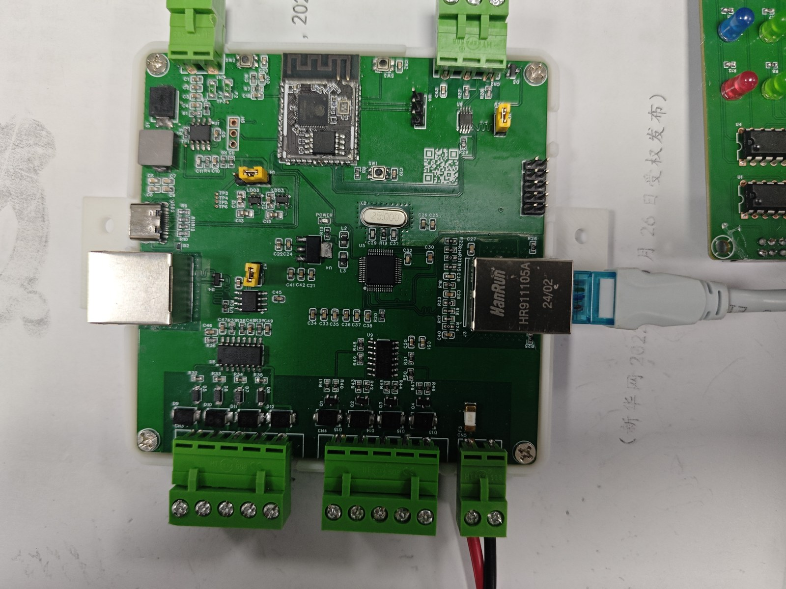

# Hardware / 硬件资料

[Browse all six schematic sheets / 查看 6 页原理图](schematics/README.md) · [Bottom enclosure STL / 3D 底壳](3d/README.md)

| 项目 | 文件 | 用途 |
| --- | --- | --- |
| 整套设计 | [嘉立创 EDA 专业版工程](ProPrj_ESP32-S3工业IO控制器_2026-11-23.epro2) | 两块 PCB 及对应原理图 |
| 原理图 | [上下板 PDF 压缩包](PDF_ESP32-S3工业I-O控制器_2026-11-23.zip) | 离线查阅连接和器件标注 |
| PCB1 下层板 | [Gerber 压缩包](Gerber_PCB1_2026-11-23.zip) | 包含外层和内层铜层、板框及钻孔 |
| PCB2 上层板 | EDA 源工程中的 PCB2 | 在 EDA 中检查规则后单独导出 Gerber |
| 两板物料 | [参考 BOM](BOM-reference.md) | PCB1 167 个位号，PCB2 34 个位号 |

装配或下单前核对两块板的板层、外形、孔位和连接器方向。贴装用物料表和坐标文件应分别从对应 PCB 页面导出。 [EDA 导出 Gerber](https://prodocs.lceda.cn/cn/pcb/export-pcb-fabrication-file-gerber/) · [EDA 导出 BOM](https://prodocs.lceda.cn/cn/pcb/export-bill-of-materials-bom/)

## GPIO mapping

### 固件 GPIO 对照

下表记录 ESP32-S3 内部信号。对外端子和板间接插件按原理图和实物版本确认。

| 功能 | 信号 | ESP32-S3 GPIO |
| --- | --- | --- |
| DI | DI1 / DI2 / DI3 / DI4 | 4 / 5 / 6 / 7 |
| MOSFET DO | DO1 / DO2 / DO3 / DO4 | 8 / 9 / 40 / 41 |
| RS485 | UART2 TX / RX / DE-RE | 21 / 47 / 48 |
| CAN | TWAI TX / RX | 16 / 17 |
| W5500 | CS / MOSI / SCK / MISO / INT / RST | 10 / 11 / 12 / 13 / 14 / 15 |
| 74HC595 | DATA / CLK / LATCH | 38 / 39 / 42 |

初次装配先断电确认上下板方向、供电端子和输入回路，再按负载接线图接入。联调 RS485 和 CAN 时先核对端子定义、极性、波特率和终端设置。

原创硬件设计文件采用 [Apache License 2.0](LICENSE)。工程内第三方库和模型保留来源和原有授权。
