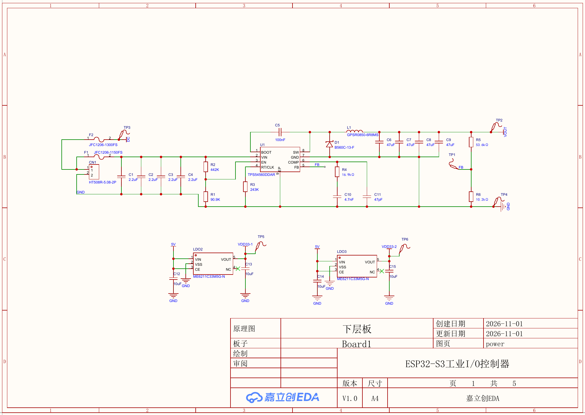
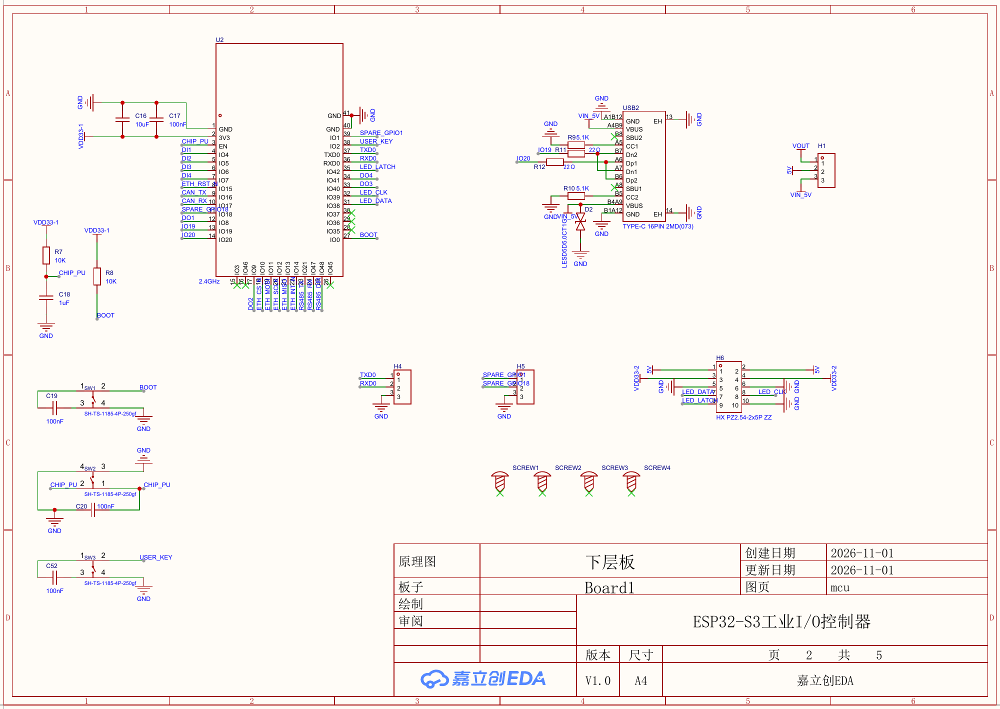
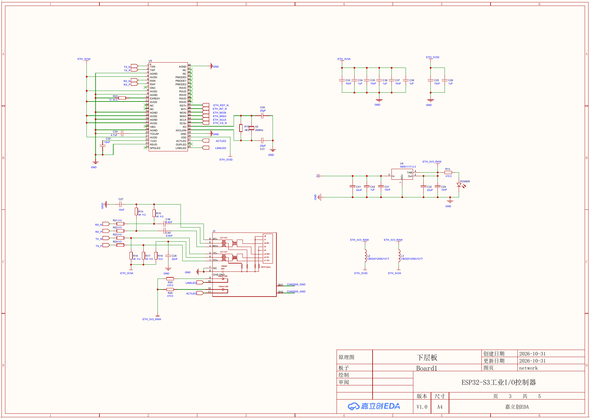
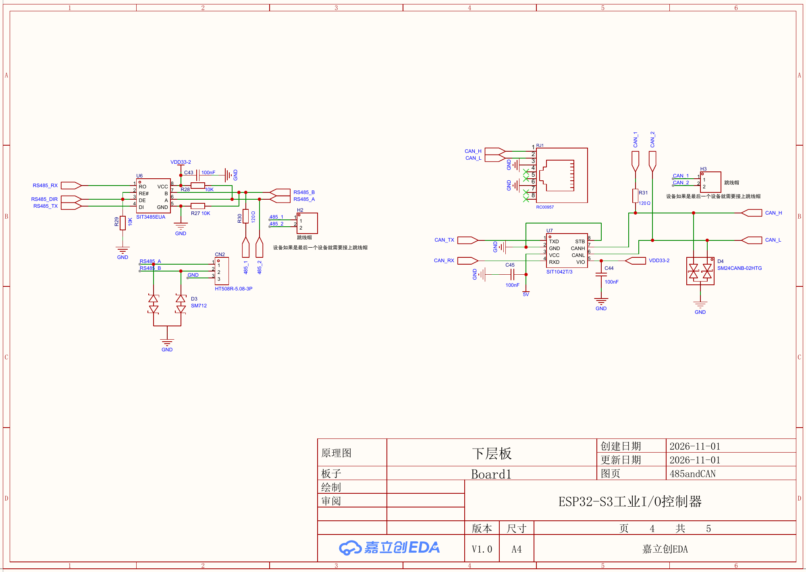
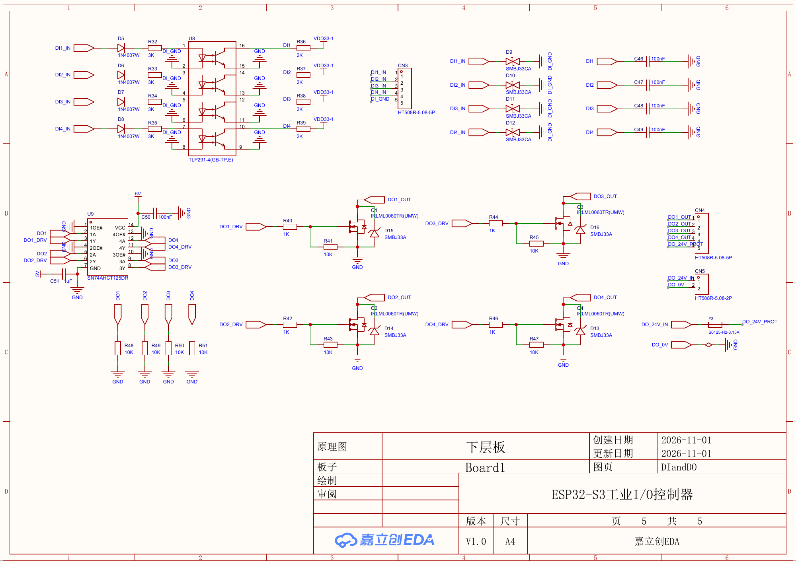
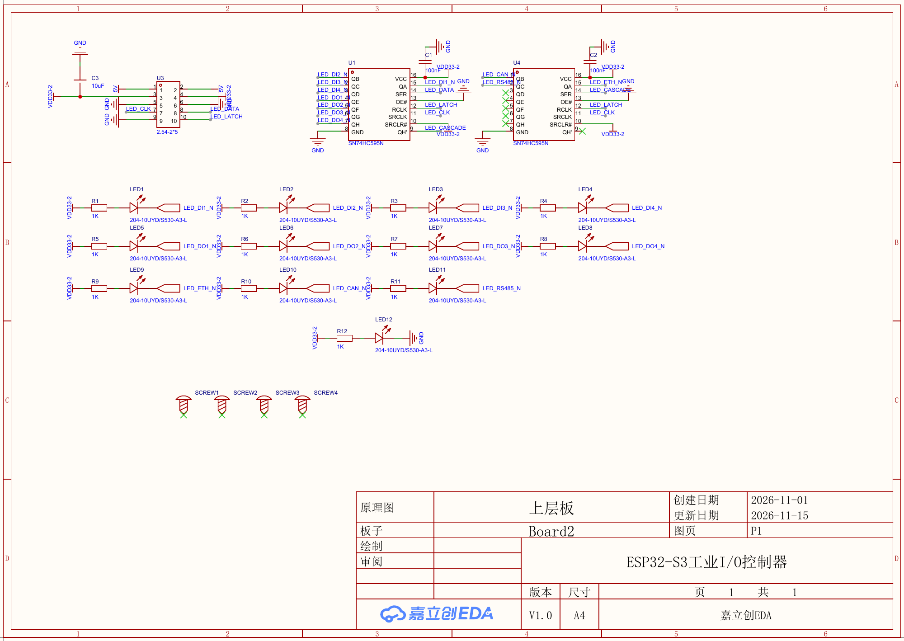

# Schematics / 原理图

The PNGs below are previews of the original schematic exports. Open the vector PDFs to read pin names and reference designators at full resolution. 下列图片来自原始导出。核对位号与网络名称时，可放大查看 [PCB1 下层板 PDF](pcb1.pdf) 和 [PCB2 上层板 PDF](pcb2.pdf)。

## PCB1 · Lower board / 下层板

### 1. Power / 电源

CN1 connects to the TPS54560 buck circuit. H1 on sheet 2 links the selected source to the 5 V rail. Sheet 1 also shows the VDD33-1 and VDD33-2 rails. 上电前核对 CN1 极性、H1 的实际跳帽位置及对应电源路径。

### 2. ESP32-S3 and board-to-board connections / 主控与板间连接

Trace GPIO net labels at U2, the USB-C and boot/reset circuits, and the H6 connector. H6 carries the LED signals and power to the upper board. 查 [固件 GPIO 对照](../README.md#gpio-mapping) 可把 DI、DO、网络、总线和指示灯信号对应到代码。

### 3. W5500 Ethernet / 有线网络

Follow the SPI nets from the MCU, the 25 MHz oscillator circuit, the Ethernet supply rails and J3 Ethernet jack. ETH_CS_N、ETH_SCLK、ETH_MOSI、ETH_MISO、ETH_INT_N、ETH_RST_N 对应固件的 W5500 SPI 和控制信号。

### 4. RS485 and CAN / 总线

RS485 uses CN2 (A/B/GND), U6 and the H2 termination jumper. CAN uses RJ1, U7 and the H3 termination jumper. Both termination resistors are marked 120 Ω. RJ1 是 CAN 接口，J3 是以太网接口。接线时按本页针脚定义核对，终端跳帽按总线拓扑设置。

### 5. Digital inputs and outputs / 数字量输入输出

CN3 brings four inputs to the TLP291-4 optocoupler. On the MCU side, the input goes low when the optocoupler conducts. CN4 brings out four low-side MOSFET outputs and the fused DO supply rail. CN5 is the DO supply input. 外部负载接线前核对 DI_GND、DO_0V、端子次序和负载条件。每路 DO 经 74AHCT125 缓冲驱动 IRLML0060TR，由 MOSFET 拉低输出。

## PCB2 · Upper board / 上层板

U3 mates with the lower-board H6. Two cascaded 74HC595 registers drive the DI/DO and communication status indicators. 通过 LED_DATA、LED_CLK 和 LED_LATCH 更新指示灯。装配前核对两块板的 1 脚方向。

